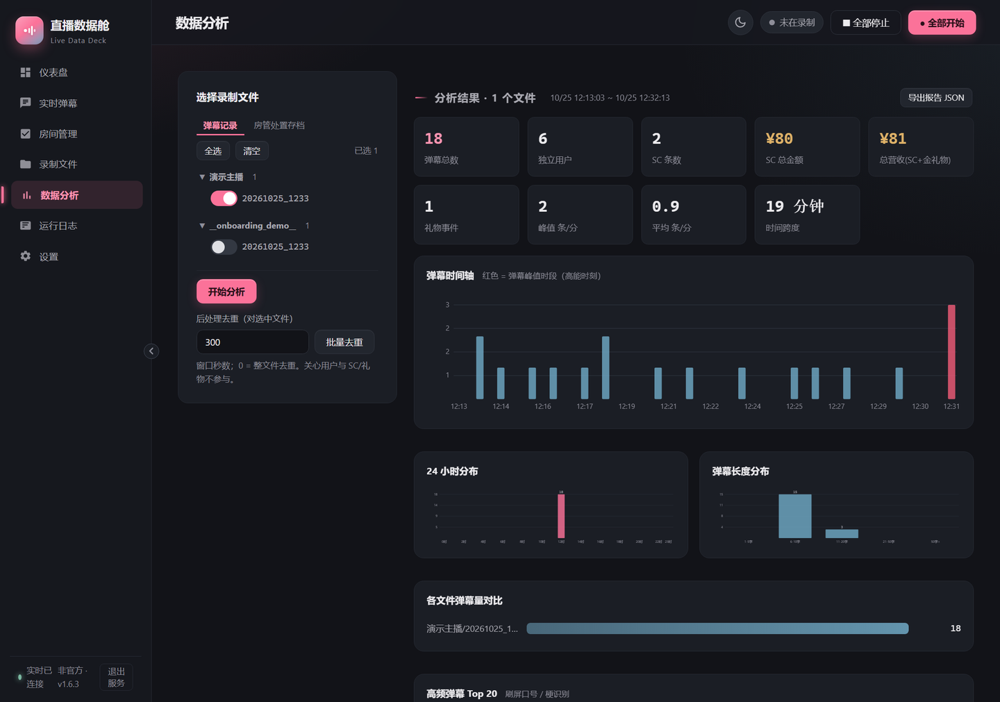
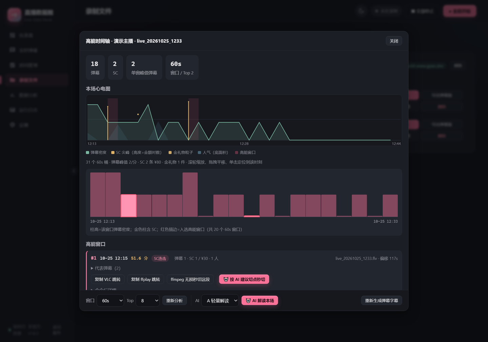
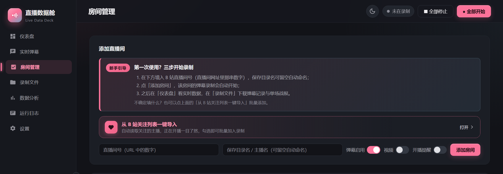
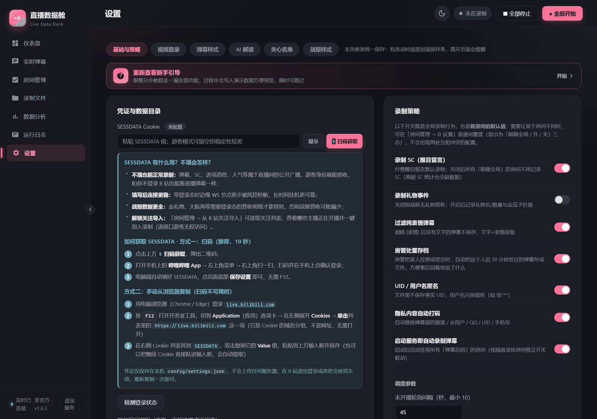

# 直播数据舱 Live Data Deck · B 站直播全数据录制与分析平台

多房间挂机录制 B 站直播**全量互动数据**，并提供统计分析与单场直播战报的本地平台：
弹幕 / SC / 礼物营收 / 观看人气曲线实时落盘，实时 Web 管理界面、跨场分析、
一键生成一页 PNG 战报；另有**可选的直播视频直录**（FLV 零转码 + 高能时间轴 +
ffmpeg 无损秒切）与 **AI 高能解读**（OpenAI 兼容接口）两个附加能力。
Python 异步核心 + FastAPI + 原生 Web UI，
**零前端构建步骤**，开箱即用。弹幕录制是本平台的能力之一。

> ⚖️ **非官方声明**：本项目是独立开源的个人作品，与哔哩哔哩（B 站 / bilibili）
> **无任何隶属、合作、授权或背书关系**，相关商标归其权利人所有。仅限录制本人或
> 已获授权的直播间，请遵守平台协议与法律法规；完整声明见文末「合规与免责声明」与 [NOTICE](NOTICE)。

> 👈 只想直接用、不想碰代码：到 **[Releases](../../releases)** 下载 Windows 绿色版 zip，
> 解压后双击 `LiveDataDeck.exe` 即可使用，详见下文「快速开始」。

## 功能特性

- **多房间同时录制**：开播自动连接、下播立即断线释放账号并发名额；未开播不占连接（45s 轮询）
- **生产级连接策略**（实战实测）：
  - wbi 签名获取 danmu token，边缘节点 host_list 自动轮换
  - 秒踢指数退避 + 随机抖动，全部节点失败自动熔断冷却，避免触发账号风控
  - `-352` 校验失败时自动重新获取 buvid 设备凭证与 wbi 签名后恢复连接
  - 浏览器同款握手头（UA / Origin / Cookie），应用层 25s 心跳
- **懒落盘**：只有真实开播（`live_status==1`）才创建文件；未开播 / 轮播内容直接丢弃
- **全数据采集**：
  - 普通弹幕、醒目留言（SC）、礼物事件（默认关闭，设置页可开）、开播 / 下播事件
  - **观看人气**：25 秒粒度 HTTP 轮询 B 站加权人气值（非真实独立人数；2026-10 起 WS 心跳固定回 1，已改走 getInfoByRoom），实时推送仪表盘并落盘，采样同时保存当时「累计看过」文案
  - **营收口径**：SC 金额 + 金礼物（金瓜子 ÷ 1000）；银瓜子免费礼物不计入营收
  - 场次头记录直播标题、封面 URL、开播时间
- **噪声过滤**：纯大表情弹幕自动过滤（`妈妈[抓狂]` 这类文字 + 表情保留）
- **隐私保护**：uid 哈希匿名（sha256 加盐）、用户名掩码、链接 / @用户 / QQ / UID / 手机号自动脱敏
- **房管处置弱标签**：房管拉黑 / 禁言时，自动回捞被处置者近 30 分钟弹幕 + 事件前 20 条语境
- **全部关播 N 分钟自动停止**，支持错峰启动避免同秒握手
- **简洁 Web UI**：仪表盘（含实时人气/峰值）、实时弹幕流、房间管理、录制文件浏览 / 预览 / 下载、运行日志、设置
- **单场直播战报（PNG）**：录制文件一键生成 1080 宽一页战报——封面 / 标题 / 主播 / 时长、弹幕数 / 独立观众 / 峰值与平均人气 / 总营收 / SC / 金礼物 / 互动速率 / 累计看过十项指标、观看人气曲线（面积折线 + 峰值标注）、弹幕分钟分布、高频弹幕 Top10 / SC 贡献榜 Top5 / 粉丝牌 Top5；历史文件无人气数据时自动降级提示，排版高度自适应
- **数据分析页**：跨主播勾选任意录制文件，生成统计报告——总览卡片（含总营收）、时间轴 / 24 小时 / 长度分布柱状图（纯 SVG）、各文件弹幕量对比、高频弹幕 Top20、活跃用户 Top20、SC 贡献榜、粉丝牌分布、高能时刻 Top5（可展开分钟样例），支持导出报告 JSON
- **后处理去重**：对指定文件执行「同用户 + 同文案 + 滑动窗口」去重（默认 300s，0 = 整文件去重），先预览重复率与刷屏样例再执行，输出 `.dedup.jsonl` **绝不覆盖原文件**；支持批量；SC / 礼物 / 场次头原样保留
- **关心用户名单**：后处理去重时名单内用户全部保留并打 `cared` 标记；支持真实 UID 或录制文件中的 16 位匿名 ID，分析页可一键加关心
- **🎥 视频直录（附加能力，默认关闭）**：HTTP-FLV 流式落盘、**零转码零新依赖**；全局总开关 + 房间级勾选双层控制，动态切换、下一场生效；原画 / 蓝光 / 超清等多档画质（游客自动降为超清，登录凭证有效才可原画，无 HEVC 授权自动回退 AVC）；断线自动分段、<5s 碎段丢弃、CDN 节点轮换、磁盘剩余低于下限自动停录并告警（弹幕录制不受影响）。一场直播三类产物：**纯净 FLV**（供剪辑，绝不烧录弹幕）、**旁挂 ASS 弹幕字幕**（VLC/mpv 可开关）、**场次 meta.json**；异常中断残留的散片在页面自动认回
- **高能时间轴**：按 60 秒桶聚合弹幕密度 / SC / 人气斜率三信号加权打分，自动给出 Top N 高能窗口（窗口 30–120s、Top 5/8/12 可调，相邻窗口自动合并、120s 抑制）；可复制 VLC / ffplay 跳转命令；本机安装 ffmpeg 并加入 PATH（**不内置**）后可一键 `-c copy` 无损秒切片段，无 ffmpeg 时自动降级为仅复制命令
- **🤖 AI 高能解读（可选）**：任意 OpenAI 兼容接口（内置 DeepSeek / 通义千问 / Kimi / 本地 Ollama 快捷模板），API Key 只存本机服务端、绝不下发浏览器。**A 轻量解读**（规则 Top 8 窗口产出切片标题 / 封面大字 / 高能理由 / 内容分类 / 建议扩切点，约 2–6K tokens）与 **C 深度策划**（全场 5 分钟段粗筛「不密但有梗」补漏窗口 + 每切片口播开场白，约 15–25K tokens）双模式；只发送弹幕文本 / SC / 时间统计，**不发送视频文件、UID、Cookie**；结果旁挂 `live_xxx.ai.json` 缓存，同模式重看不重复扣费；可开启正常下播后自动分析
- **直播心电图**：整场走势五层信号叠加——弹幕密度（面积主轨迹）、SC 尖峰（高度 = 金额）、金礼物粒子、观看人气、高能窗口；鼠标滚轮缩放、拖拽平移、单击某时刻即跳到对应视频分段。仪表盘房间卡底部另有近 60 分钟迷你波形（分钟桶只计数、不含弹幕文本，随快照下发不增加可感知流量）
- **新手引导**：首次打开自动弹出 24 步分步教程，半透明蒙版逐模块高亮讲解（含自动打开高能时间轴弹窗、自动跑一次演示分析）；教程期间临时生成三类演示数据，结束或跳过即清除，服务重启也会清理残留。「上一步 / 下一步」按钮、键盘 ↑ ↓（含 PageUp / PageDown）、鼠标滚轮均可翻步，Esc 跳过；设置页「基础与策略」顶部「重新查看新手引导」可随时重看
- **命令行模式**：无界面挂机 / 临时单房间录制同样支持

> 人气值为 B 站加权人气指标，不等于真实在线人数；2026-10 前的历史录制文件无该字段，
> 战报与分析会显示「无数据」，无法回填。

## 界面预览

> 截图取自开发环境的新手引导演示数据（虚拟主播与匿名观众），不含任何真实用户信息；
> 界面为默认的深色主题。

<table>
<tr>
<td width="50%" valign="top">
<br>
<sub><b>数据分析</b>：勾选任意场次生成跨文件统计报告，含总览卡片、弹幕时间轴、24 小时与长度分布，以及高频弹幕 / 活跃用户 / SC 贡献榜。</sub>
</td>
<td width="50%" valign="top">
<br>
<sub><b>高能时间轴</b>：弹幕密度、SC、人气斜率三信号加权的直播心电图，自动给出高能窗口，可复制播放器跳转命令或交给 AI 解读。</sub>
</td>
</tr>
<tr>
<td width="50%" valign="top">
<br>
<sub><b>房间管理</b>：按直播间号添加录制目标，弹幕录制、视频直录、开播提醒都可按房间单独开关。</sub>
</td>
<td width="50%" valign="top">
<br>
<sub><b>设置</b>：凭证与录制策略分区管理，改动后统一保存，离开页面前会提示未保存内容。</sub>
</td>
</tr>
</table>

## 快速开始（下载即用，推荐）

无需安装 Python 或任何环境，只想直接用的话走这条路径：

### 1. 下载绿色版

到本仓库 **[Releases](../../releases)** 页下载最新的
`LiveDataDeck-x.y.z-windows-x64.zip`（公开仓库，任何 GitHub 账号均可直接下载）。

支持 Windows 10/11 64 位。macOS / Linux 用户请见文末「源码运行」。

### 2. 解压

把压缩包完整解压到任意目录（如 `D:\LiveDataDeck\`），保持文件夹结构不变——
`LiveDataDeck.exe` 必须和 `_internal` 文件夹在一起，**不要只拖出 exe**。

### 3. 启动

双击 **`LiveDataDeck.exe`**：启动时会闪一下黑色控制台窗口显示启动日志，程序就绪后它会自动隐藏，
约 1 秒后浏览器自动打开 <http://127.0.0.1:8787>；没有自动打开就手动输入该地址。
**退出程序**：点页面侧边栏底部的「**退出服务**」，或右键任务栏通知区域的程序图标选「退出」——
两者都会先把正在录制的房间收尾，再关闭服务。包内附有一份《使用说明.txt》，面向非技术用户。

### 4. 首次配置（仅需一次）

1. **填写登录凭证**：打开「**设置**」页，粘贴 `SESSDATA`（不填可走游客模式，但容易被边缘节点秒踢）。
   获取方式：浏览器登录 <https://live.bilibili.com> → F12 → Application（应用）→ Cookies
   → 找到 `SESSDATA`，复制其值粘贴保存，页内可一键检测登录态。
2. **设置数据目录**（可选）：默认录制数据保存在程序目录下 `data/`；要换位置（如数据盘）
   在设置页填写绝对路径即可。
3. **打开礼物录制**（战报需要）：设置页打开「**录制礼物事件**」开关。
   不开启则后续战报只有 SC 营收、没有金礼物营收；开启前的历史文件无法补录。
4. **添加直播间**：在「**房间管理**」添加房间号（直播间 URL 中的数字）和保存目录名（建议填主播名），
   保存后立即开始轮询；主播开播即自动录制、下播自动断线。设置页「自动启动录制」开启时，
   以后每次启动程序都会自动连接所有启用的房间。

> 绿色版中 `SESSDATA` 只保存在程序目录下 `config/settings.json`，不会上传任何第三方；
> 换机 / 升级时拷贝 `config/` 和 `data/` 两个文件夹即可完整迁移。
> 如遇杀软误报，将程序目录加入信任区。

### 5. 视频直录与 AI 高能解读（可选附加能力）

视频与弹幕录制完全解耦，默认关闭，不影响原有录制：

1. **开启视频**：设置页「🎥 视频直录」打开**全局总开关**（仅对之后启动的录制任务生效，
   运行中的任务需手动停止再开始），再到「房间管理 / 仪表盘」为目标房间勾选「🎥 视频」
   （运行中可切换，下一场开播生效）。
2. **选画质**：原画约 1.4–3.6 GB/小时（页面内有各档参考）；未填 SESSDATA 的游客会被
   B 站降为超清，有效登录凭证才能取原画；HEVC 不可用时自动回退 AVC。
3. **磁盘保护**：默认剩余空间低于 5 GB 自动停录视频并告警，5 分钟后复检；弹幕照常录制。
4. **看产物**：「视频录制」页按场次列出 FLV（含断线分段）、ASS 字幕与元数据，
   可下载 / 删除；异常中断产生的散片会单独列出认回。文件落在 `data/video/<主播目录>/`。
5. **找高能、切片段**：场次行点「**高能时间轴**」——三信号时间轴标出 Top N 高能窗口，
   可复制 VLC/ffplay 跳转命令；在本机安装 ffmpeg 并加入 PATH 后（工具**不内置** ffmpeg），
   可直接按窗口「无损秒切」出 `clip_*.flv`（`-c copy` 不重编码、秒级完成）。
6. **AI 解读（可选）**：设置页「🤖 AI 高能解读」填入任意 OpenAI 兼容接口
   （或本地 Ollama）与模型名，「测试连接」通过后，在高能时间轴弹窗选 A/C 模式点
   「🤖 AI 解读本场」；也可打开「场次结束后自动解读」，正常下播自动跑一次。
   结果缓存在场次旁挂的 `live_xxx.ai.json`，同模式重复打开不重复扣费，切模式或点
   「重新分析」才会再次调用模型。

> 费用与隐私：AI 分析只发送弹幕文本片段 / SC / 时间统计到你自己配置的接口，
> 不发送视频文件、UID、Cookie；API 调用费用按服务商计价、由你承担，模型文案请自行把关。

### 6. 日常使用

| 你想做的事 | 操作 |
| --- | --- |
| 看录制是否正常 / 当前人气 | 「仪表盘」看房间卡片状态徽章、标题、实时人气与历史峰值 |
| 看实时弹幕 | 「实时弹幕」页，可按房间 / 类型过滤，SC / 礼物分色 |
| 开播 / 停录某个房间 | 房间卡片或房间管理页的单个开始 / 停止按钮（即时生效，无需重启） |
| **生成单场战报** | 「录制文件」→ 找到对应 `live_YYYYMMDD.jsonl` → 点「**战报**」→ 弹窗查看摘要 → 点「生成 PNG 一页战报」，图片在新标签页打开，右键即可另存 |
| 跨场 / 跨主播分析 | 「数据分析」勾选多个文件 → 生成统计报告（总量、趋势图、Top 榜、高能时刻），可导出 JSON |
| 清理刷屏重复弹幕 | 「录制文件」对单个文件点「去重」先预览再执行；分析页支持批量去重。产物为 `.dedup.jsonl`，**原文件永不覆盖** |
| 重点盯某个人 | 分析页活跃用户可一键「加关心」，去重时该用户弹幕全部保留并打 `cared` 标记 |
| 同时录直播视频 | 设置页打开全局视频开关，再为房间勾选「🎥 视频」；详见第 5 步 |
| 找高能时刻 / 切片段 | 「视频录制」→ 场次行「高能时间轴」：看三信号 Top N 窗口、复制播放器跳转命令；装了 ffmpeg 可直接无损秒切 |
| 让 AI 写切片文案 | 高能时间轴弹窗选 A/C 模式 →「🤖 AI 解读本场」（需先在设置页配置接口；也可开启播后自动解读） |
| **退出程序** | 点侧边栏底部「退出服务」，或右键通知区域图标 →「退出」；两种方式都会先把正在录的弹幕文件收尾再关服务 |

### 7. 战报与历史数据说明

- 战报包含封面、标题、十项指标（弹幕数 / 独立观众 / 峰值平均人气 / 总营收 / SC / 金礼物 /
  弹幕峰值 / 互动速率 / 累计看过）、人气曲线、弹幕分钟分布和三个榜单。
- **人气曲线**需要 2026-10-13 后新版录制产生的 `popularity` 数据（25 秒 HTTP 采样）；更早的历史文件无此数据，
  战报对应区域会显示缺数据提示，其余内容正常。
- 总营收 = SC 金额 + 金礼物（金瓜子 ÷ 1000）；银瓜子免费礼物不计。
- 「累计看过」有两个来源：主播直播中生成战报时在线补全；或使用新版录制器在直播中随人气采样保存的 `watched`。
  该数据 B 站在下播后即重置、且不提供历史场次查询，旧场次无法补取。

### 8. 进阶：启动参数与局域网共享

在 exe 所在目录地址栏输入 `cmd` 回车，可带参数启动：

```bat
LiveDataDeck.exe --port 9000        REM 换端口（默认 8787）
LiveDataDeck.exe --no-browser       REM 不自动开浏览器（服务器挂机）
LiveDataDeck.exe --host 0.0.0.0     REM 监听局域网，供他人访问 http://你的IP:8787
```

> **多人共用推荐部署**：选一台常开的电脑以 `--host 0.0.0.0 --no-browser` 常驻，
> 其他人直接浏览器访问该地址看仪表盘、做分析、出战报，不必每个人各跑一份
> （同一 SESSDATA 多实例同时连接会互相挤线）。
> 源码模式另有命令行无界面录制器 `python -m recorder.cli`，见文末。

### 9. 使用与安全约定（重要）

每个运行实例（绿色版为解压目录，源码运行为项目目录）中，以下内容只保存在本机、
**不要外传、不要提交仓库**：

- `config/settings.json`（含 SESSDATA、数据目录）、`config/targets.json`（房间列表）、`.env`
- `data/` 整个数据目录（弹幕含用户言论，本地留存）

需要注意：

- 每个实例用**自己的 SESSDATA**，不要在公开场合或对话里传播 cookie；泄露后立即去 B 站下线该会话。
- `匿名盐`（设置页 / `DANMAKU_ANON_SALT`）决定用户哈希：同一盐才能跨文件、跨机器关联同一观众。
  多人做联合分析时应统一盐值（线下约定），改盐后新旧文件的用户将对不上。
- 推荐只用一个常驻实例录制（见第 8 步）；多实例同时用同一账号连接会触发 B 站并发限制互相秒踢。
- 房间列表的增删建议由维护人统一在常驻实例的 Web 上操作。

### 10. 常见问题

- **双击 exe 没反应 / 提示缺少 dll**：确认整个文件夹（含 `_internal`）一起解压了；杀软可能误报，
  将程序目录加入信任区后重试。
- **启动报端口被占用**：`LiveDataDeck.exe --port 9000`（绿色版）或 `python run.py --port 9000`（源码）。
- **房间一直重连 / 秒踢**：多半是游客模式或账号同时在播房间过多。先在设置页填好 SESSDATA；
  单账号同时在播房间建议不超过 3–4 个，程序已内置节点轮换与熔断，仍不行就减少同时录制数。
- **战报人气区显示无数据**：该文件录于人气采集上线前，属于正常现象。
- **独立观众数偏小**：2026-10 之前的旧文件没有匿名 uid，只能按掩码昵称估算，会偏低。
- **开了视频开关却没录**：全局开关只对**开启之后启动**的录制任务生效，先在房间卡片停止再开始；
  且需要该房间也勾选「🎥 视频」（下一场开播生效）。
- **视频只能录超清 / 录不到原画**：未填或 SESSDATA 已失效时 B 站只给游客画质；
  去设置页重新填写并检测登录态。
- **高能时间轴无数据**：该视频场次缺少同日弹幕 jsonl（视频与弹幕需同日同主播录制），
  规则检测与 AI 解读都依赖弹幕数据，视频文件本身不受影响。
- **秒切按钮不可用**：页面顶栏显示「未检测到 ffmpeg」；到 ffmpeg.org 下载 Windows 版、
  把 bin 目录加入系统 PATH 后重启程序即可，不装也能复制 VLC/ffplay 跳转命令手动定位。
- **AI 解读报错 / 连不上**：先用设置页「测试连接」检查 Base URL、Key、模型名；
  本地 Ollama 需先 `ollama pull` 对应模型并保持服务运行。
- **想再看一遍新手引导**：设置页「基础与策略」面板顶部的「重新查看新手引导」点一下即从第一步重来；
  教程期间临时生成的演示数据（目录名 `__onboarding_demo__`）在结束或跳过后自动清除，不会混进真实录制目录。
- **心电图怎么操作 / 房间卡那条波浪是什么**：视频场次页「高能时间轴」里的本场心电图支持滚轮缩放、
  拖拽平移、单击某时刻跳转到对应视频分段；仪表盘房间卡底部那条迷你波形是近 60 分钟的互动节奏
  （分钟桶计数，不含弹幕文本）。
- **教程高分 / 挖孔框闪了一下**：属早期版本缺陷，v1.6.0 起换步时挖孔直接落位、弹窗正文未渲染完不画框，
  刷新页面拿到新前端资源即可（浏览器可能缓存旧文件，必要时 Ctrl+F5 强刷）。
- **升级新版**：下载新 zip 解压到新目录，把旧目录的 `config/` 和 `data/` 拷过去即可。
- **想开机自启 / 后台常驻**：Windows 可用「任务计划程序」在登录时执行
  `LiveDataDeck.exe --no-browser`。

## Web 界面

| 页面 | 功能 |
| --- | --- |
| 仪表盘 | 在录房间 / WS 连接 / 弹幕总数 / 实时速率统计；房间卡片（状态徽章、标题、节点、重连次数、**实时人气与峰值**、分类计数、单房间启停） |
| 实时弹幕 | WebSocket 实时推送，按房间 / 类型过滤，SC / 礼物 / 房管处置分色展示，支持暂停滚动 |
| 房间管理 | 添加 / 删除目标、启用开关、单个开始 / 停止，动态生效无需重启 |
| 录制文件 | 按主播目录浏览 jsonl，在线预览（JSON 美化）与下载，**单文件一键 PNG 战报**，单文件去重（预览后另存） |
| 视频录制 | 视频场次与散片浏览 / 下载 / 删除，**高能时间轴**（三信号 Top N 窗口、VLC/ffplay 跳转命令、ffmpeg 无损秒切、按 AI 建议切点秒切、重新生成 ASS 字幕），A/C 双模式 AI 解读；顶栏显示 ffmpeg 检测状态 |
| 数据分析 | 文件树勾选（按主播分组 / 全选、跨主播多选），统计报告与柱状图、高能时刻展开、高频文案复制、活跃用户一键加关心、批量去重、报告 JSON 导出 |
| 运行日志 | 连接、风控、熔断、房管处置等事件实时日志，按级别过滤 |
| 设置 | SESSDATA 与登录态检测、匿名盐、数据目录、录制开关、轮询与空闲停止参数、关心用户名单管理、**视频直录**（全局开关 / 画质 / 磁盘下限 / 保存目录）、**AI 高能解读**（接口模板 / Key / 模式 / 连接测试 / 自动解读） |

## 数据格式

```
{data_dir}/   # 默认项目内 data/，可在设置页修改；子目录名也可在配置中改
├── records/{主播目录}/live_YYYYMMDD.jsonl        # 弹幕 / 人气 / SC / 礼物
├── weak_label/{主播目录}/weak_YYYYMMDD.jsonl     # 房管处置弱标签
└── video/{主播目录}/                             # 视频直录产物（附加功能）
    ├── live_YYYYMMDD_HHMM.flv                    # 首段纯净 FLV（HTTP-FLV 零转码，不烧弹幕）
    ├── live_YYYYMMDD_HHMM.pNN.flv                # 断线重连分段（时间戳不连续，暂不自动合并）
    ├── live_YYYYMMDD_HHMM.ass                    # 旁挂弹幕字幕（VLC/mpv 可加载、可开关）
    ├── live_YYYYMMDD_HHMM.meta.json              # 场次元数据：分段 / 时间戳 / 画质
    ├── live_YYYYMMDD_HHMM.ai.json                # AI 高能解读结果缓存（使用 AI 功能后生成）
    └── clip_<秒>.flv                              # ffmpeg 无损秒切出的片段
```

每行一个 JSON 对象：

- 文件首行 `session_header`：房间号、主播、标题、`cover_url`（封面）、`live_start`（开播时间）、采集时间
- `danmaku`：`text` / `uid_anon` / `uname_anon` / `medal`（粉丝牌名+等级）/ `ts` / `mode`
- `popularity`：`ts` / `popularity`，约 25 秒一行的加权人气采样（HTTP 轮询，2026-10-13 起）；
  直播中还带 `watched`（如 `"7513人看过"`，采样时的累计看过，赛后战报用它）
- `super_chat`：额外含 `price_rmb`（元，直接计入营收）
- `gift`：`gift_name` / `num` / `coin_type`（`gold` / `silver`）/ `total_coin`（金瓜子）/
  `discount_price`；营收仅统计 `coin_type=="gold"` 的 `total_coin/1000`，银瓜子免费礼物不计
- `moderation_event`：房管拉黑 / 禁言事件、`suspect_danmaku`（被处置者弹幕）、
  `context_before`（语境）。**弱标签不是金标准**（可能误封、可能是广告剧透），使用前需人工判断
- 后处理去重产物 `live_YYYYMMDD.dedup.jsonl` 与原文件同目录、同格式；
  命中关心名单的弹幕行会追加 `"cared": true`，便于下游筛选
- 视频目录中的 `.meta.json`（分段清单 / 起止时间戳 / 画质，供高能时间轴对齐）与
  `.ai.json`（AI 解读结果缓存）均为 UTF-8 JSON 文本，可直接查看；删除视频场次会一并清理

> 旧文件弹幕行可能 `uid_anon` 为空（仅掩码名），此时独立观众数按掩码名估算，会偏低。

## 协议与稳定性说明

- 单账号同时挂多个**在播**房间存在并发上限（实测约 3–4 个），超出的连接会被 0s 踢断。
  本工具的策略是「未开播不持有 WS + 下播立即断线 + 全节点失败熔断」，把连接数压到当前在播数；
  若同时在播长期超过上限仍被踢，请减少同时录制数或改用多账号。
- B 站接口与风控策略可能随时调整；连接逻辑基于 2026-09 实测验证。

## 合规与免责声明

- **非官方**：本项目是独立开发的开源个人作品，与哔哩哔哩股份有限公司及其关联方
  （以下统称"B 站"）无任何隶属、合作、授权或背书关系。"哔哩哔哩 / B 站 / bilibili"
  等名称及相关标识均为其权利人的商标，本文档仅在说明功能适用对象时作指示性使用，不主张任何相关权利。
- **接口性质**：本工具通过浏览器正常访问直播页面时调用的同类 Web 接口独立实现功能，
  **未接入官方开放平台授权接口、未使用任何专有 SDK**；此类接口不属于平台对外承诺的开放服务，
  可能随时调整或被限制，不保证持续可用；如平台方提出异议，使用者应立即停止使用。
- **账号与凭证自担风险**：SESSDATA 是你本人的敏感登录凭证，仅保存在本机
  `config/settings.json`、不经过任何第三方服务器；填写凭证可能产生的账号风险由使用者自行承担，
  请勿在多设备 / 多人之间共享同一凭证。
- **录制边界（重要）**：仅限录制**本人直播，或已取得主播 / 权利人明确授权**的直播间，
  用途限于个人备份、直播复盘与数据研究。**不得**用于盗录、绕过付费或权限限制、
  大规模抓取、商业转售、干扰平台正常服务，或帮助他人从事上述行为。
- **内容与隐私**：直播画面、声音、弹幕、SC、礼物等内容的著作权及相关权益归主播或相应权利人所有；
  录制数据包含用户言论，请勿公开传播或用于侵权用途。默认的 uid 哈希与文本脱敏
  **不保证完全去除可识别信息**，对外分享数据文件前请自行审查。
- **AI 解读的数据外发（可选功能，默认关闭）**：使用 AI 高能解读时，会将该场弹幕文本片段、
  SC 内容与时间统计发送到**你自行配置**的 OpenAI 兼容接口（本地 Ollama 等自托管服务除外）；
  不会发送视频文件、用户 UID、Cookie 或 SESSDATA，API Key 仅保存在本机 `config/settings.json`。
  是否发送、发给谁完全由你的配置决定；模型服务方的数据政策请自行确认，调用费用自行承担，
  模型输出可能有误，切片标题 / 文案请人工把关后再使用。
- **网络暴露**：Web 管理界面无内置登录鉴权。使用 `--host 0.0.0.0` 共享时仅限可信局域网，
  **切勿直接暴露到公网**，否则任何人都可查看数据并操作你的录制任务。
- **免责**：依据 MIT 许可证，本软件按"现状"提供，作者不对任何直接或间接损失负责。
  因使用本工具产生的纠纷、封禁或法律责任，均由使用者自行承担。

第三方组件许可证清单（httpx / websockets / FastAPI / Pillow / certifi 等，均为宽松许可）
见 [NOTICE](NOTICE)。

## 源码运行与自行打包（维护者）

绿色版仅提供 Windows x64。macOS / Linux 用户或想二次开发的用户从源码运行：

```bash
git clone https://github.com/white8tterfly/live-data-deck.git
cd live-data-deck
python -m venv .venv
# Windows: .venv\Scripts\Activate.ps1    macOS/Linux: source .venv/bin/activate
pip install -r requirements.txt
python run.py                  # Web 界面
python -m recorder.cli --help  # 无界面命令行录制器（--room/--duration/--idle-stop/--keep-gifts）
```

发布 Windows 绿色版（在 Windows 机器上执行）：

```bash
pip install pyinstaller
pyinstaller LiveDataDeck.spec --noconfirm --clean
# 产物在 dist/LiveDataDeck/；组装发布目录时拷入 packaging/使用说明.txt 与空 config/、data/，
# 切勿拷入本机 config/settings.json（含 SESSDATA）。
```

发布前必须实测：从 zip 解压后的目录直接启动 exe，访问首页与 `/api/state`，
并用一条最小录制数据验证 `/api/report/image` 能正常出 PNG。

## 技术栈

Python 3.10+ · asyncio · httpx · websockets · FastAPI · uvicorn · Pillow（PNG 战报渲染）· PyInstaller（绿色版打包）· 原生 HTML/CSS/JS（无构建）· ffmpeg（可选，仅高能片段秒切，不内置、需自行安装并加入 PATH）

## License

[MIT](LICENSE)，第三方组件与商标声明见 [NOTICE](NOTICE)。
