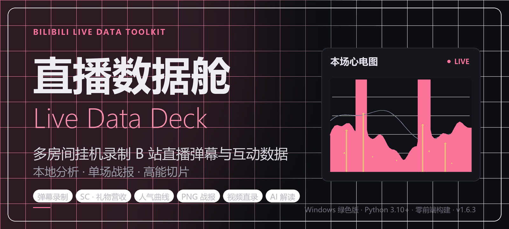

<div align="center">

# 直播数据舱 Live Data Deck _(live-data-deck)_



[](https://github.com/RichardLitt/standard-readme)
[](LICENSE)
[](https://www.python.org/)

**本地运行的多房间 B 站直播数据工具：弹幕录制、SC 与礼物营收、人气曲线、单场 PNG 战报、视频直录与 AI 高能解读。**

</div>

一场直播结束后，弹幕、SC、礼物和人气曲线往往散落在页面里，复盘只能靠记忆和手动截图。Live Data Deck 把这件事变成一次挂机：填好房间号，开播自动连接、下播自动断开，所有互动数据按场次写入本地 JSONL；需要时一键生成一页 PNG 战报，或跨主播、跨场次做对比分析。

弹幕录制是核心能力；视频直录与 AI 高能解读是可选附加能力，独立开关、默认关闭。服务运行在本机，凭证与录制数据不离开你的电脑；前端是原生 HTML / CSS / JS，没有构建步骤，开箱即用。

本项目是非官方独立作品，与哔哩哔哩无隶属、合作、授权或背书关系。开始使用前，请先读[安全与合规](#安全与合规)。

## 目录

- [安全与合规](#安全与合规)
- [界面预览](#界面预览)
- [核心能力](#核心能力)
- [安装](#安装)
- [使用](#使用)
- [数据格式](#数据格式)
- [常见问题](#常见问题)
- [技术栈与项目结构](#技术栈与项目结构)
- [参与贡献](#参与贡献)
- [许可证](#许可证)

## 安全与合规

- **非官方工具**：本项目独立开发，未接入 B 站官方开放平台，也不使用任何专有 SDK；所用接口可能随时调整或受限，不保证持续可用。相关商标归权利人所有。
- **录制边界**：仅限录制本人直播，或已取得主播 / 权利人明确授权的直播间；用途限于个人备份、直播复盘与数据研究。不得用于盗录、绕过付费或权限限制、大规模抓取、商业转售。
- **凭证只在本地**：SESSDATA 与 AI Key 只保存在本机 `config/settings.json`，不会上传第三方，也不会下发到浏览器。请勿在公开场合复制或传播 cookie。
- **隐私处理是概率性的**：uid 哈希加盐、昵称掩码、链接 / @ / QQ / UID / 手机号脱敏只能降低可识别性，不保证完全匿名。对外分享数据文件前请自行审查。
- **不要暴露到公网**：Web 管理界面没有内置登录鉴权。`--host 0.0.0.0` 只适合可信局域网；直接暴露公网等于把录制数据和操作权限交给任何人。
- **AI 解读会外发文本**：只有你主动启用时，才会把该场弹幕文本、SC 与时间统计发送到**你自行配置**的接口；不会发送视频、UID、Cookie 或 SESSDATA。模型费用与输出准确性由使用者承担。

完整的商标声明、第三方依赖许可与免责条款见 [NOTICE](NOTICE)。

## 界面预览

> 截图取自新手引导的演示数据（虚拟主播与匿名观众），不含任何真实用户信息；界面为默认深色主题。

<table>
<tr>
<td width="50%" valign="top">
<br>
<sub><b>数据分析</b>：勾选任意场次生成跨文件统计报告，含总览卡片、弹幕时间轴、24 小时与长度分布，以及高频弹幕 / 活跃用户 / SC 贡献榜。</sub>
</td>
<td width="50%" valign="top">
<br>
<sub><b>高能时间轴</b>：弹幕密度、SC、人气斜率三信号加权的直播心电图，自动给出高能窗口，可复制播放器跳转命令或交给 AI 解读。</sub>
</td>
</tr>
<tr>
<td width="50%" valign="top">
<br>
<sub><b>房间管理</b>：按直播间号添加录制目标，弹幕录制、视频直录、开播提醒都可按房间单独开关。</sub>
</td>
<td width="50%" valign="top">
<br>
<sub><b>设置</b>：凭证与录制策略分区管理，改动后统一保存，离开页面前会提示未保存内容。</sub>
</td>
</tr>
</table>

## 核心能力

### 弹幕录制与数据采集

- **多房间挂机**：开播自动连接、下播立即断线释放并发名额；未开播不持有长连接，按 45 秒轮询开播状态。
- **生产级连接策略**：wbi 签名获取弹幕 token，边缘节点自动轮换；秒踢走指数退避加随机抖动，全部节点失败后熔断冷却；`-352` 校验失败时重新获取 buvid 与 wbi 签名后恢复。
- **全量互动数据**：普通弹幕、醒目留言（SC）、礼物事件、开播 / 下播事件与观看人气。人气按 25 秒粒度通过 HTTP 轮询 B 站加权人气值，并同时保存当时的「累计看过」文案。
- **营收口径**：SC 金额 + 金礼物（金瓜子 ÷ 1000）；银瓜子免费礼物不计入营收。只有真实开播（`live_status == 1`）才创建文件，轮播内容直接丢弃。
- **隐私与弱标签**：uid 哈希匿名、用户名掩码、文本脱敏；房管拉黑 / 禁言时自动回捞被处置者近 30 分钟弹幕与事件前 20 条语境，作为弱标签供人工判断。

### 复盘与分析

- **单场 PNG 战报**：一键生成 1080 宽一页战报，包含封面、标题、主播、时长、十项指标、观看人气曲线、弹幕分钟分布，以及高频弹幕 / SC 贡献 / 粉丝牌三个榜单。历史文件缺人气数据时自动降级提示。
- **跨场数据分析**：跨主播勾选任意录制文件，生成总览卡片、时间轴 / 24 小时 / 时长分布柱状图（纯 SVG）、各文件弹幕量对比、高频弹幕 Top 20、活跃用户 Top 20、SC 贡献榜、粉丝牌分布与高能时刻 Top 5，可导出报告 JSON。
- **后处理去重**：按「同用户 + 同文案 + 滑动窗口」去重，默认窗口 300 秒，填 0 表示整文件去重；先预览重复率与刷屏样例再执行，产物为 `.dedup.jsonl`，**绝不覆盖原文件**，支持批量。
- **关心用户名单**：名单内用户在去重时全部保留并打 `cared` 标记；支持真实 UID 或录制文件中的 16 位匿名 ID，分析页可一键添加。

### 可选附加能力（默认关闭）

- **视频直录**：HTTP-FLV 流式落盘，零转码、零新增依赖。全局总开关加房间级勾选，双层控制、下一场生效；支持原画 / 蓝光 / 超清等画质，断线自动分段，小于 5 秒的碎段丢弃，CDN 节点轮换，磁盘剩余低于下限自动停录并告警。产物为纯净 FLV、旁挂 ASS 弹幕字幕与场次 `meta.json`，**绝不烧录弹幕**。
- **高能时间轴**：按 60 秒桶聚合弹幕密度、SC、人气斜率三信号加权打分，给出 Top 5 / 8 / 12 高能窗口（窗口 30–120 秒，相邻窗口合并，120 秒抑制），可复制 VLC / ffplay 跳转命令。本机安装 ffmpeg 并加入 PATH 后可一键无损秒切，无 ffmpeg 时降级为仅复制命令。
- **AI 高能解读**：支持任意 OpenAI 兼容接口，内置 DeepSeek / 通义千问 / Kimi / 本地 Ollama 模板。A 轻量解读产出切片标题、封面大字、高能理由与建议扩切点；C 深度策划补漏窗口并写口播开场白。结果缓存为旁挂 `live_xxx.ai.json`，同模式重看不重复扣费。
- **直播心电图**：弹幕密度、SC 尖峰、金礼物粒子、观看人气、高能窗口五层信号叠加；滚轮缩放、拖拽平移、单击某时刻跳到对应视频分段。仪表盘房间卡底部另有近 60 分钟迷你波形。
- **新手引导与命令行**：首次打开有 24 步分步教程，演示数据结束即清除；也支持 `python -m recorder.cli` 无界面挂机或临时单房间录制。

> 人气值是 B 站加权人气指标，不等于真实在线人数；2026-10 之前的录制文件没有该字段，战报与分析会显示「无数据」，无法回填。

## 安装

### 方式一：下载 Windows 绿色版（推荐）

无需安装 Python，解压即用，支持 Windows 10 / 11 64 位。

1. 到本仓库 **[Releases](../../releases)** 页下载最新的 `LiveDataDeck-x.y.z-windows-x64.zip`。
2. 把压缩包完整解压到任意目录，保持文件夹结构不变。`LiveDataDeck.exe` 必须和 `_internal` 文件夹在一起，不要只拖出 exe。
3. 双击 `LiveDataDeck.exe`。启动时会短暂显示控制台日志，就绪后自动隐藏并打开 <http://127.0.0.1:8787>；没有自动打开就手动访问该地址。
4. 退出时点侧边栏底部的「退出服务」，或右键任务栏通知区域的程序图标选「退出」。两种方式都会先收尾正在录制的文件再关闭服务。

需要在命令行改端口或供局域网访问时：

```bat
LiveDataDeck.exe --port 9000
LiveDataDeck.exe --no-browser
LiveDataDeck.exe --host 0.0.0.0
```

macOS / Linux 请使用下面的源码运行方式。绿色版包内附有面向非技术用户的《使用说明.txt》。

### 方式二：从源码运行

需要 Python 3.10 或更高版本。

```bash
git clone https://github.com/white8tterfly/live-data-deck.git
cd live-data-deck
python -m venv .venv
# Windows: .venv\Scripts\Activate.ps1
# macOS / Linux: source .venv/bin/activate
pip install -r requirements.txt
python run.py
```

默认监听 `127.0.0.1:8787`，可用 `--port` / `--host` / `--no-browser` 调整。无界面模式使用 `python -m recorder.cli`。

自行打包 Windows 绿色版需要安装 PyInstaller，执行 `pyinstaller LiveDataDeck.spec --noconfirm --clean`；产物在 `dist/LiveDataDeck/`。组装发布目录时拷入 `packaging/使用说明.txt` 与空的 `config/`、`data/`，**切勿拷入本机的 `config/settings.json`**（含 SESSDATA）。

## 使用

### 首次配置

1. **填写登录凭证**：打开「设置」页，粘贴 `SESSDATA`。不填也能以游客模式运行，但容易被边缘节点秒踢。
   获取方式：浏览器登录 <https://live.bilibili.com>，按 F12 → Application（应用）→ Cookies → 找到 `SESSDATA`，复制其值。设置页内可一键检测登录态。
2. **设置数据目录（可选）**：默认录制数据保存在程序目录下的 `data/`；要换到数据盘，在设置页填写绝对路径。
3. **打开礼物录制**：设置页打开「录制礼物事件」。不开启则战报只有 SC 营收、没有金礼物营收；开启前的历史文件无法补录。
4. **添加直播间**：在「房间管理」填写房间号（直播间 URL 中的数字）与保存目录名（建议用主播名）。保存后立即开始轮询，开播自动录制、下播自动断线。打开「自动启动录制」后，以后每次启动都会自动连接所有启用的房间。

### 日常操作

| 想做的事 | 操作 |
| --- | --- |
| 看录制是否正常 / 当前人气 | 「仪表盘」查看房间状态、标题、实时人气与历史峰值 |
| 看实时弹幕 | 「实时弹幕」页，按房间 / 类型过滤，SC 与礼物分色展示 |
| 开始 / 停止某个房间 | 房间卡片或房间管理页的单个开始 / 停止按钮，即时生效 |
| 生成单场战报 | 「录制文件」→ 找到 `live_YYYYMMDD.jsonl` → 点「战报」→ 查看摘要 → 生成 PNG 一页战报 |
| 跨场 / 跨主播分析 | 「数据分析」勾选多个文件 → 生成统计报告（总量、趋势图、Top 榜、高能时刻），可导出 JSON |
| 清理刷屏重复弹幕 | 「录制文件」单文件去重，先预览再执行；分析页支持批量。产物为 `.dedup.jsonl`，原文件永不覆盖 |
| 重点盯某个人 | 分析页活跃用户一键「加关心」，去重时该用户弹幕全部保留并打 `cared` 标记 |
| 同时录直播视频 | 设置页打开全局视频开关，再为房间勾选「视频」；详见下一节 |
| 找高能时刻 / 切片段 | 「视频录制」→ 场次行「高能时间轴」→ 查看 Top N 窗口、复制播放器跳转命令；装了 ffmpeg 可直接无损秒切 |
| 让 AI 写切片文案 | 高能时间轴弹窗选 A / C 模式 →「AI 解读本场」（需先在设置页配置接口，也可开启播后自动解读） |
| 退出程序 | 点侧边栏底部「退出服务」，或右键通知区域图标 →「退出」 |

### 视频直录与 AI 高能解读

视频与弹幕录制完全解耦，默认关闭，不影响原有录制：

1. **开启视频**：设置页打开「视频直录」的**全局总开关**（只对之后启动的录制任务生效，运行中的任务需手动停止再开始），再到「房间管理 / 仪表盘」为目标房间勾选「视频」（运行中可切换，下一场开播生效）。
2. **选择画质**：原画约 1.4–3.6 GB/小时（页面内有各档参考）。未填 SESSDATA 的游客会被降为超清，有效登录凭证才能取原画；HEVC 不可用时自动回退 AVC。
3. **磁盘保护**：默认剩余空间低于 5 GB 自动停录视频并告警，5 分钟后复检；弹幕录制不受影响。
4. **查看产物**：「视频录制」页按场次列出 FLV（含断线分段）、ASS 字幕与元数据，可下载 / 删除；异常中断产生的散片会单独列出供认回。
5. **找高能、切片段**：场次行点「高能时间轴」，可复制 VLC / ffplay 跳转命令；本机安装 ffmpeg 并加入 PATH 后可按窗口无损秒切出 `clip_*.flv`（`-c copy`，不重编码）。
6. **AI 解读（可选）**：设置页「AI 高能解读」填入任意 OpenAI 兼容接口或本地 Ollama 与模型名，「测试连接」通过后即可在高能时间轴弹窗运行 A / C 模式；也可打开「场次结束后自动解读」。结果缓存在旁挂 `live_xxx.ai.json`，同模式重复打开不重复扣费。

> AI 分析只发送弹幕文本片段、SC 与时间统计到你自行配置的接口，不发送视频文件、UID、Cookie 或 SESSDATA。调用费用按服务商计价、由你承担，模型文案请人工把关。

### 局域网共享

想多人共用时，选一台常开的电脑以 `--host 0.0.0.0 --no-browser` 常驻，其他人直接用浏览器访问该地址看仪表盘、做分析、出战报，不必每人各跑一份。同一 SESSDATA 多实例同时连接会互相挤线；Web 界面没有登录鉴权，只适合可信局域网。

### 无界面录制

```bash
python -m recorder.cli --help
```

支持 `--room` / `--duration` / `--idle-stop` / `--keep-gifts`，适合服务器挂机或临时录一个房间。

## 数据格式

录制数据默认落在 `data/`，可在设置页改位置：

| 路径 | 内容 |
| --- | --- |
| `records/{主播目录}/live_YYYYMMDD.jsonl` | 弹幕、SC、礼物、人气与场次头 |
| `weak_label/{主播目录}/weak_YYYYMMDD.jsonl` | 房管处置弱标签 |
| `video/{主播目录}/live_*.flv` | 视频直录分段（纯净流，不烧弹幕） |
| `video/{主播目录}/live_*.ass` | 旁挂弹幕字幕，VLC / mpv 可加载、可开关 |
| `video/{主播目录}/live_*.meta.json` | 场次元数据：分段清单、起止时间戳、画质 |
| `video/{主播目录}/live_*.ai.json` | AI 高能解读结果缓存 |
| `video/{主播目录}/clip_<秒>.flv` | ffmpeg 无损秒切出的片段 |

`live_YYYYMMDD.jsonl` 每行一个 JSON 对象：

- `session_header`：文件首行，记录房间号、主播、直播标题、`cover_url`、`live_start` 与采集时间。
- `danmaku`：`text` / `uid_anon` / `uname_anon` / `medal`（粉丝牌名与等级）/ `ts` / `mode`。
- `popularity`：`ts` / `popularity`，约 25 秒一行的加权人气采样；直播中还带 `watched`（如 `"7513人看过"`）。
- `super_chat`：额外含 `price_rmb`，直接计入营收。
- `gift`：`gift_name` / `num` / `coin_type`（`gold` / `silver`）/ `total_coin`（金瓜子）/ `discount_price`；只有 `gold` 的 `total_coin / 1000` 计入营收。
- `moderation_event`：房管拉黑 / 禁言事件，含 `suspect_danmaku` 与 `context_before`。弱标签不是金标准，可能误封或是广告剧透，使用前需人工判断。

去重产物 `live_YYYYMMDD.dedup.jsonl` 与原文件同目录、同格式；命中关心名单的弹幕行追加 `"cared": true`。旧文件的弹幕行可能没有 `uid_anon`，此时独立观众数按掩码昵称估算，会偏低。

## 常见问题

| 现象 | 处理 |
| --- | --- |
| 双击 exe 没反应 / 提示缺少 DLL | 确认整个文件夹（含 `_internal`）一起解压；杀软可能误报，将程序目录加入信任区 |
| 启动提示端口被占用 | 绿色版用 `LiveDataDeck.exe --port 9000`；源码用 `python run.py --port 9000` |
| 房间一直重连 / 秒踢 | 先在设置页填好 SESSDATA；单账号同时在播房间建议不超过 3–4 个，仍不行就减少同时录制数 |
| 战报人气区显示无数据 | 该文件录于人气采集上线（2026-10-13）之前，属于正常现象，无法回填 |
| 独立观众数偏小 | 旧文件没有匿名 uid，只能按掩码昵称估算 |
| 开了视频开关却没录 | 全局开关只对开启之后启动的任务生效；先停止房间再开始，且该房间也要勾选「视频」 |
| 视频只能录超清 / 录不到原画 | 未填或 SESSDATA 已失效时平台只给游客画质；重新填写并检测登录态 |
| 高能时间轴无数据 | 该视频场次缺少同日弹幕文件；视频与弹幕需同日同主播录制，规则检测与 AI 解读都依赖弹幕 |
| 秒切按钮不可用 | 页面顶栏显示「未检测到 ffmpeg」；安装 ffmpeg 并把 `bin` 加入系统 PATH 后重启程序 |
| AI 解读报错 / 连不上 | 先用设置页「测试连接」检查 Base URL、Key 与模型名；本地 Ollama 需先 `ollama pull` 并保持服务运行 |
| 想再看一遍新手引导 | 设置页「基础与策略」顶部的「重新查看新手引导」 |
| 想开机自启 / 后台常驻 | Windows「任务计划程序」在登录时执行 `LiveDataDeck.exe --no-browser` |
| 升级新版 | 下载新 zip 解压到新目录，把旧目录的 `config/` 与 `data/` 拷过去 |

## 技术栈与项目结构

Python 3.10+ · asyncio · httpx · websockets · FastAPI · uvicorn · Pillow（PNG 战报渲染）· PyInstaller（绿色版打包）· 原生 HTML / CSS / JS（无构建）· ffmpeg（可选，仅高能片段秒切，不内置）。

| 路径 | 说明 |
| --- | --- |
| `recorder/` | 核心录制包：连接、落盘、视频直录、高能检测、AI 解读、分析与战报 |
| `server/` | FastAPI 应用（`app.py` 路由、`schemas.py` 模型） |
| `web/` | 原生单页前端（`index.html` / `app.js` / `styles.css`） |
| `config/` | 运行时配置（含 SESSDATA，**不提交**） |
| `data/` | 录制数据（含用户言论，**不提交**） |
| `packaging/` | 绿色版使用说明与打包脚本 |
| `run.py` | Web 界面启动入口 |
| `LiveDataDeck.spec` | PyInstaller 打包定义 |
| `tests/` | 自动化测试（`requirements-dev.txt` 为开发依赖） |

## 参与贡献

欢迎通过 [Issues](../../issues) 反馈问题或提出需求。提交 PR 前建议先开 Issue 对齐方向，保持一次改动只做一件事，并在描述里说明「为什么」。

- 提交前请运行 `pytest`，确保现有用例通过。
- 不要提交 `config/`、`data/`、`.env` 或任何凭证；不要在 Issue / PR 中粘贴 SESSDATA。
- 涉及录制核心链路的改动，请说明对断线重连、风控与磁盘占用的影响。
- 安全问题请通过仓库主页的联系方式私下告知，不要公开披露细节。

维护者：[@white8tterfly](https://github.com/white8tterfly)。

## 许可证

[MIT](LICENSE) © 2026 white8tterfly

第三方组件许可证与商标声明见 [NOTICE](NOTICE)。
